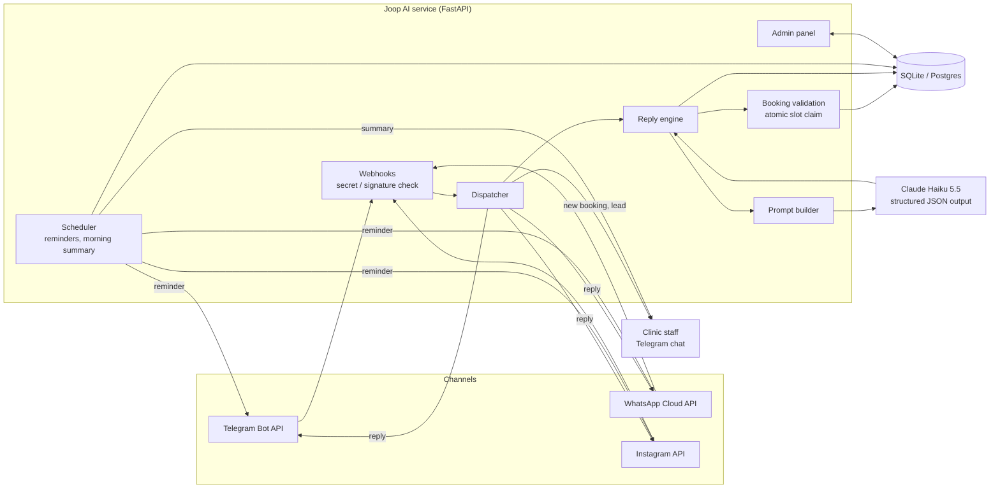
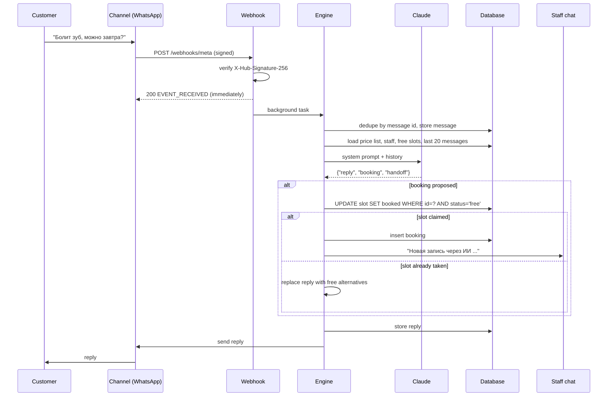
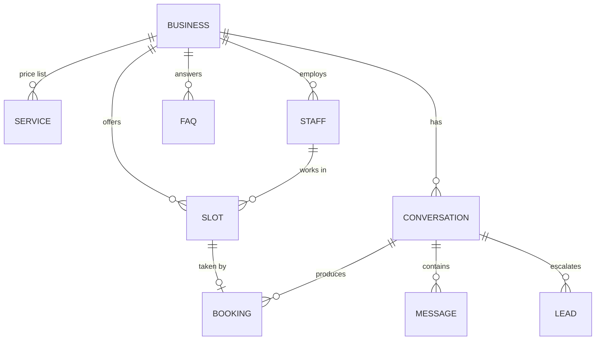

# Architecture

Joop AI is one Python service. It receives customer messages from messaging channels, lets a
language model draft the reply, checks every action the model proposes against the database, and
shows the business what happened in a web panel.

## Components

## One message, end to end

## Data model

Every table carries `business_id`, so one deployment serves many businesses (multi-tenant).

## Design decisions

1. **The model proposes, the code decides.** The model returns JSON with an optional `booking`. The
   engine books only if the slot exists, belongs to this business, is in the future and is still
   free. The claim is one conditional `UPDATE`, so two customers can never get the same slot. If the
   check fails, the customer gets real alternatives instead of the model's confirmation.
2. **Structured output with a safety net.** Requests ask for a JSON schema. If the API rejects an
   optional setting, the client drops it and retries, and the parser also accepts JSON inside text.
   A failed call never leaves the customer without an answer: they get a fallback message and staff
   get a lead.
3. **Staff can take over.** When a clinic replies by hand from its own Instagram or WhatsApp app,
   the channel sends an "echo". Echoes that match our own replies are ignored; any other echo pauses
   the AI in that conversation for 12 hours. Staff can also pause or resume the AI in the panel.
4. **At-least-once webhooks, exactly-once replies.** Channels retry deliveries. Every stored message
   keeps its channel message id, and a repeated id is dropped before any work is done.
5. **Off-hours is measured, not guessed.** Each message and booking records whether it arrived
   outside the business's working hours. That is the pilot's headline number: how many customers
   were served while nobody was at the desk.
6. **Secrets stay on the server.** Channel tokens are write-only in the panel, never logged, and
   request URLs that contain the Telegram token are not logged either. Meta webhooks are rejected
   unless their signature matches the app secret.
7. **Time convention.** `*_at` columns are UTC; slot and booking start times are the business's
   local time. The business timezone is a setting (default Asia/Bishkek).

## Code map

| Path | Responsibility |
|---|---|
| **Conversation core** | |
| `joop/agent/prompt.py` | System prompt from the business's data; message history mapping |
| `joop/agent/llm.py` | Claude client, response schema per niche, tolerant JSON parsing |
| `joop/agent/engine.py` | One message in: commands, media, pause, model call, checks of every booking, order and lead, language and confirmation guards |
| `joop/dispatch.py` | Runs the engine in a DB session, then delivers the reply and staff notes |
| `joop/channels/` | Telegram, WhatsApp and Instagram parsing and send clients; Telegram polling |
| `joop/lang.py`, `joop/kyrgyz.py` | Kyrgyz/Russian heuristics; Kyrgyz drafts of service names and FAQ |
| `joop/slots.py`, `joop/stays.py` | Time slots with an atomic claim; hotel nights booked atomically |
| **Niches and modules** | |
| `joop/niches/<name>/` | Niche packs: labels, outcomes, rules, demo data, evaluation dialogues |
| `joop/placement.py`, `joop/memberships.py`, `joop/jobs.py`, `joop/waitlist.py`, `joop/intake.py` | Level tests, passes, order status, waiting list, questions before a visit |
| `joop/followups.py`, `joop/faq_gaps.py` | Ratings and return invitations; questions handed to staff as FAQ candidates |
| **Platform** | |
| `joop/web/app.py` | FastAPI app: the owner's panel and the channel webhooks |
| `joop/web/saas.py`, `joop/billing.py`, `joop/partners.py` | Sign-up, test chat, billing (FreedomPay, transfers), founder console, referrals |
| `joop/web/demo.py`, `joop/web/studio.py`, `joop/web/menu.py` | Live demo on the site, AI-drafted business sites, online menu with QR codes |
| `joop/altegio.py` | Altegio integration: prices, team and free times in, bookings out |
| `joop/stats.py` | Numbers for the dashboard, reports and the pilot |
| **Operations** | |
| `joop/scheduler.py` | Reminders, summaries, weekly report, Altegio sync, daily backup |
| `joop/health.py` | Alerts for the founder when model calls keep failing |
| `joop/ops.py` | Pre-launch check (`python -m joop check`) and database backups |
| `joop/crypto.py`, `joop/security.py` | Channel tokens encrypted at rest; password hashing |
| `joop/migrations/` | Alembic migrations, run on start |
| **Quality** | |
| `tests/` | 270 tests with a fake model, fake channels and a fake Altegio API |
| `eval/` | Scripted dialogues on the real model; results on the `eval-results` branch |
