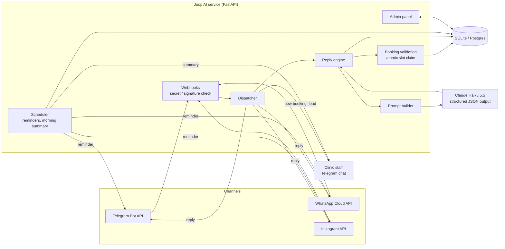
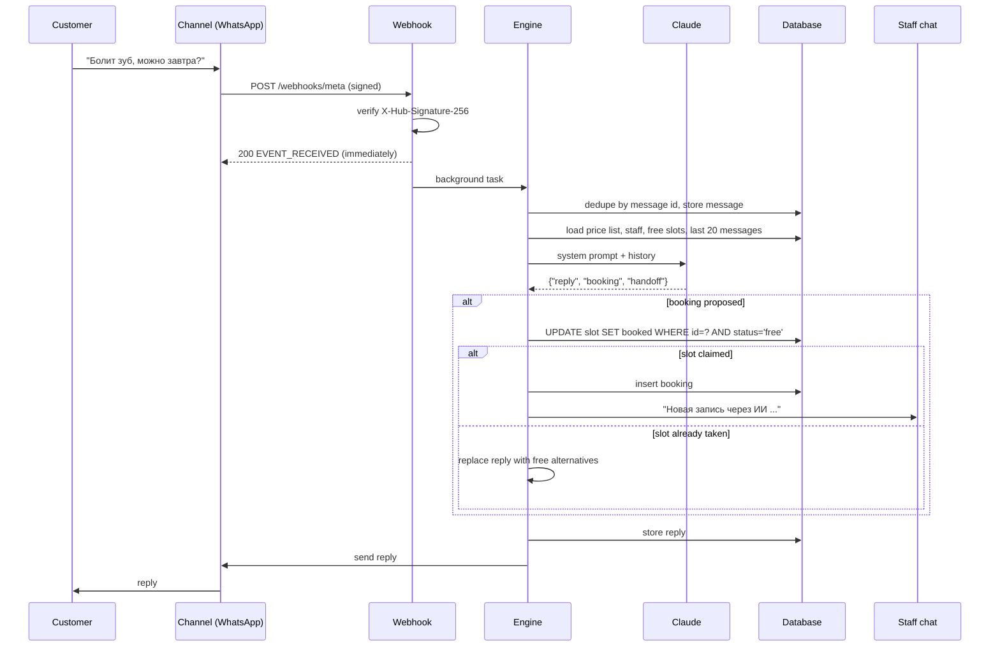
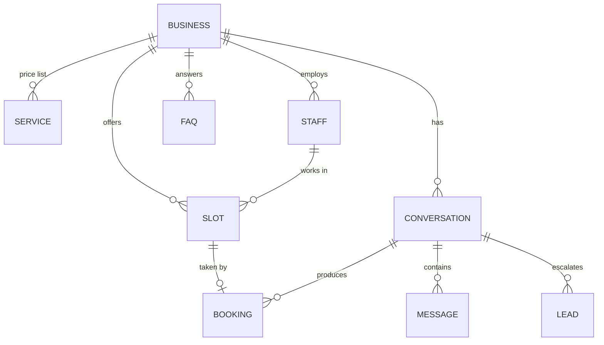

# Architecture

Joop AI is one Python service. It receives customer messages from messaging channels, lets a
language model draft the reply, checks every action the model proposes against the database, and
shows the business what happened in a web panel.

## Components

## One message, end to end

## Data model

Every table carries `business_id`, so one deployment serves many businesses (multi-tenant).

## Design decisions

1. **The model proposes, the code decides.** The model returns JSON with an optional `booking`. The
   engine books only if the slot exists, belongs to this business, is in the future and is still
   free. The claim is one conditional `UPDATE`, so two customers can never get the same slot. If the
   check fails, the customer gets real alternatives instead of the model's confirmation.
2. **Structured output with a safety net.** Requests ask for a JSON schema. If the API rejects an
   optional setting, the client drops it and retries, and the parser also accepts JSON inside text.
   A failed call never leaves the customer without an answer: they get a fallback message and staff
   get a lead. When the model answers again, customers still waiting (no staff reply, request still
   open, at most 12 hours, Telegram/WhatsApp/Instagram) get a real answer that starts with an apology
   for the delay, and their requests are closed (`joop/recovery.py`).
3. **Staff can take over.** When a clinic replies by hand from its own Instagram or WhatsApp app,
   the channel sends an "echo". Echoes that match our own replies are ignored; any other echo pauses
   the AI in that conversation for 12 hours. Staff can also pause or resume the AI in the panel.
   The AI also hands a chat over by itself when the chat makes it answer too often: 60 answers in an
   hour or 200 in a day (`engine._answers_spent`). That is somebody's auto-reply or bot answering every
   message of ours, or a person playing, and each answer is a paid model call with no end to it. The
   customer gets one line («Дальше вам ответит администратор»), staff get one request of kind
   `limit`, and the AI is silent in that chat for an hour (a day, when it happens again within a day)
   or until staff turn it back on; the count then starts from the stop. The owner's test chat has no
   limit.
4. **At-least-once webhooks, exactly-once replies.** Channels retry deliveries. Every stored message
   keeps its channel message id, and a repeated id is dropped before any work is done. One chat's
   messages take turns (`engine.chat_turn`, a lock in memory: one process serves everything), so a
   delivery repeated moments later finds the first already stored, and a second message sent in a row
   is answered with the first reply in its history. A message that arrives while its chat is being
   answered does not wait in a thread: it goes to the chat's queue in memory and the thread that is
   answering takes it next (`dispatch.process_incoming`). One chat uses one of the 40 threads
   for customers however many messages it sends. Measured with 80 messages sent to one chat and a 1-second
   model call: before, the login page did not open for 30 seconds and another customer got no answer
   in that time; after, the page opens in 0.03 s and the other customer is answered in 1.2 s. More
   than 50 waiting in one chat are not read: staff are told once and the dialogue keeps a note of how
   many. A message in work for over five minutes no longer holds its chat: the next message or the
   scheduler's tick takes the queue over. One POST of Meta carries messages of several chats: the
   chats are answered side by side, and a chat's own messages join its queue together, in their order.
   A route written `async def` (the site chat, the site demo, a test result, a test broadcast, the
   saving of «Каналы», a studio draft, and every one that writes to the database) reads its form
   on the event loop and hands everything that waits on the model, a messenger or SQLite's write
   lock to a worker thread (`run_in_threadpool`); called on the loop itself, one such wait froze
   every request. A limit counted in such a route (the site chat's, the demo's) is checked and
   counted in one locked step before the answer, and given back if the answer fails: checked on
   the loop and counted after the model, eight messages sent at once all passed a limit of two. Measured with three site-chat visitors at once and a
   3-second model: before, /health took 8.9 s and the visitors were answered after 3.2, 6.2 and
   9.2 s; after, /health takes 0.02 s and all three are answered in 3.2 s. `tests/test_event_loop.py`
   fails on any such call made from an `async def` in `joop/web`.
   Customers are answered in threads of their own (`joop/workers.py`, 40 at a time): messages from
   the channels, the site chat and the demo. Pages and the rest of the background work keep
   Starlette's 40. Measured with 150 chats at once and a 3-second model: before, the login page took
   up to 9.04 s to open; after, 0.05 s. The 151st customer is still answered after 12.9 s: forty
   at a time is the limit of how many the model answers at once, not of the pages.
5. **No model call inside a database transaction.** SQLite lets one connection write at a time, from
   its first write to commit. The engine commits before each model call (`db.free`),
   so a slow answer to one customer never stops another business's customers, the panel or the
   scheduler, and the customer's message is kept even if the call fails. Measured before the fix: ten
   customers at once with a 3-second call were answered one after another and five got nothing
   («database is locked»); after it, forty at once all got their answer in under four seconds.
   A session that must stay one unit sets `session.info["atomic"]` (the founder's pitch demo).
   The same rule holds for every send to a messenger (the tests fail any send made while the
   database is write-locked) and for Altegio: a sync asks Altegio everything first and writes after
   (`altegio.fetch`); a booking saves its claim of the slot before the two Altegio calls and marks it
   `altegio.on_the_way`, so a sync that lands in between does not take «booked here, free in Altegio,
   no booking yet» for a visit cancelled in Altegio.
6. **Off-hours is measured, not guessed.** Each message and booking records whether it arrived
   outside the business's working hours. That is the pilot's headline number: how many customers
   were served while nobody was at the desk.
7. **Secrets stay on the server.** Channel tokens are write-only in the panel, never logged, and
   request URLs that contain the Telegram token are not logged either. Meta webhooks are rejected
   unless their signature matches the app secret.
8. **Time convention.** `*_at` columns are UTC; slot and booking start times are the business's
   local time. The business timezone is a setting (default Asia/Bishkek).

## Code map

| Path | Responsibility |
|---|---|
| **Conversation core** | |
| `joop/agent/prompt.py` | System prompt from the business's data; message history mapping |
| `joop/agent/llm.py` | Claude client, response schema per niche, tolerant JSON parsing |
| `joop/agent/openai_compat.py` | Second model provider: any OpenAI-compatible API (development and evaluation; docs/model-providers.md) |
| `joop/agent/engine.py` | One message in: commands, media, pause, model call, checks of every booking, order and lead, language and confirmation guards |
| `joop/dispatch.py` | Keeps one thread per chat (a queue in memory for messages that arrive while the chat is being answered), takes the chat's turn (before a voice message is recognised, until the reply is sent), runs the engine in a DB session, then sends staff notes and waiting-list offers outside the turn |
| `joop/workers.py` | The 40 threads that answer customers (channel messages, the site chat, the demo), apart from Starlette's 40 that serve pages |
| `joop/channels/` | Telegram, WhatsApp and Instagram parsing and send clients; Telegram polling |
| `joop/lang.py`, `joop/kyrgyz.py` | Kyrgyz/Russian heuristics; Kyrgyz drafts of service names and FAQ |
| `joop/ky_phrases.py` | Every fixed Kyrgyz phrase in the code with its Russian twin, for a native speaker: `python -m joop ky-phrases --csv`, `/owner/kyrgyz` |
| `joop/slots.py`, `joop/stays.py` | Time slots with an atomic claim; hotel nights booked atomically |
| **Niches and modules** | |
| `joop/niches/<name>/` | Niche packs: labels, outcomes, rules, demo data, evaluation dialogues |
| `joop/placement.py`, `joop/memberships.py`, `joop/jobs.py`, `joop/waitlist.py`, `joop/intake.py`, `joop/area_price.py`, `joop/repeat_order.py`, `joop/routes.py`, `joop/prescription.py`, `joop/holds.py`, `joop/reorders.py`, `joop/restock.py` | Level tests, passes, order status, waiting list, questions before a visit, estimates for prices per m², the last order ready to repeat, prices by route, prescription medicines for pickup only, reservations that expire, reminders to repeat an order, «напишем, когда появится» |
| `joop/followups.py`, `joop/faq_gaps.py` | Ratings and return invitations; questions handed to staff as FAQ candidates |
| `joop/web/accounts.py` | Staff logins (`PanelUser`); owner-only sections are listed in `app.py` (`OWNER_ONLY`) |
| `joop/staff_reply.py` | Staff reply from the panel through the customer's channel; web chat updates |
| `joop/schedule.py` | Closing and opening times by hand (an ill doctor's day): `closed` slots stay closed through cancellations and moves; reopened ones go to the waiting list; Altegio schedules refused |
| `joop/selfservice.py` | The customer cancels or moves their own booking in the chat: the chat's bookings in the prompt, `change` in the answer, checked and done by code; what it may not do goes to staff |
| `joop/reschedule.py` | Moving a booking to another free time from the panel and the app: the slot is claimed as the AI claims it, the old one goes to the waiting list, the customer is told; only visits that have not happened |
| `joop/nudges.py` | Reminders to staff about requests nobody answered |
| `joop/autofill.py`, `joop/web/autofill.py` | Price list and FAQ drafted from pasted text, kept only where the text supports it |
| `joop/mcp.py` | MCP server for other AI assistants: prices, free times, booking through the API's rules |
| `joop/confirmations.py` | After a booking, order or stay: the time, date, composition and sum the customer reads come from the saved action; a claim sentence naming other ones is removed |
| `joop/missed_calls.py` | A missed call (from the owner's phone or a PBX) becomes a WhatsApp message to the caller and a note to staff |
| `joop/tgbusiness.py` | Which Telegram Business connection is answered: only one made by an account linked as the alerts chat |
| `joop/sitefetch.py` | The visible text of the owner's web page for that draft: public addresses only, pinned connection, checked redirects, size limit |
| `joop/voice.py` | Voice messages: download from the channel, speech-to-text, then answered like text |
| `joop/audit.py`, `joop/web/audit.py` | The free chat audit: WhatsApp export parser, the numbers a prospect loses, the lead form |
| `joop/case.py` | A business's case with real numbers for a period, for the founder to publish |
| `joop/pitch.py` | Founder's demo on a prospect's own price list: autofill, slots, a scripted dialogue, a page to screenshot |
| `joop/free_plan.py` | Free plan for one master: eligibility, the Joop signature on first replies and bookings |
| `joop/trust.py` | AI self-disclosure at first contact; week-one dialogue review in the morning summary |
| `joop/upsell.py` | One add-on offered by code after a booking; "да" adds it |
| `joop/owner_commands.py` | /today, /week, /gaps, /help in the staff Telegram chat: the numbers by code |
| `joop/ig_comments.py` | Which Instagram comments get a Direct reply (questions, keywords); the client sends through the comment |
| `joop/gaps.py` | Empty slots for the week and the regulars to invite into them; the owner sends with one click |
| `joop/regulars.py` | The returning customer's last visits and upcoming booking, one line for the prompt |
| `joop/unfinished.py` | One follow-up with two free times to a customer who asked and went quiet |
| `joop/confirm.py` | "да" to the reminder confirms the visit; unconfirmed list for the morning summary; optional release |
| `joop/deposits.py` | Prepayment after an AI booking: details and deadline, receipts to staff, release when unpaid |
| `joop/broadcasts.py`, `joop/web/broadcasts.py` | Broadcasts to customer groups within channel rules, "стоп" to unsubscribe, batches in day hours |
| **Platform** | |
| `joop/web/app.py` | FastAPI app: the owner's panel and the channel webhooks |
| `joop/samples.py` | Which rows are still the sign-up example (fictional prices, staff, answers): flagged on the dashboard, not counted as done |
| `joop/web/saas.py`, `joop/billing.py`, `joop/partners.py` | Sign-up, test chat, billing (FreedomPay, transfers, cancel/resume), founder console, referrals |
| `joop/period_end.py` | The owner told in the morning summary before the trial or paid month ends and the AI stops; staff notes for customers who write after the stop |
| `joop/web/demo.py`, `joop/web/studio.py`, `joop/web/menu.py` | Live demo on the site, AI-drafted business sites, online menu with QR codes |
| `joop/altegio.py` | Altegio integration: prices, team and free times in, bookings out |
| `joop/crm.py` | amoCRM / Kommo: bookings, requests and orders sent as deals with contact and note |
| `joop/retention.py` | Retention at 30/90 days and first-week dialogues the owner checked, for the pilot page |
| `joop/stats.py` | Numbers for the dashboard, reports and the pilot; test chats are left out of all of them and of amoCRM and the API: the panel test chat (`TEST_CHANNEL`) and Telegram chats where the owner or staff try their own bot (`Conversation.staff_test`: the alerts chat, `/start test_<Business.test_link_code>` from «Каналы» (secret, so customers cannot mark their own chat), or the web chat in a browser logged in to the panel). No test reaches Altegio or broadcasts; a Telegram or web test still gets reminders and holds a real slot (prepayment deadlines release it), so the owner sees the flow work. «Считать клиентом» in the dialogue undoes the mark. Use `not_test()`, `real_conversation()` and `real_messages()` for any new number |
| **Operations** | |
| `joop/scheduler.py` | Reminders, summaries, weekly, monthly and day-7 reports, broadcast batches, prepayment deadlines, request reminders, amoCRM deals, Altegio sync, daily backup |
| `joop/stock.py` | Stock for goods sold in the chat: the order checks the count, takes it, returns it on cancel, takes the item off sale at zero, warns at the minimum; recount = inventory with history |
| `joop/cash.py` | Visit payments (amount pre-filled from the price list, method) and the day's/month's cash by method, master and service; a line in the morning summary |
| `joop/funnel.py` | Sales funnel for requests (new → contacted → booked → visited / lost) moved from bookings, orders and staff replies; 30-day conversions |
| `joop/customers.py` | Customer cards assembled from bookings, orders and dialogues by phone; notes and tags; CSV export |
| `joop/stories.py` | Instagram stories for Joop's own account: slide texts, rendered by `story.html` at 1080 × 1920, exported by `scripts/export_stories.py` |
| `joop/annual.py` | The year offer at the end of the second paid month: who is due, the text in their numbers, the console reminder |
| `joop/founder_digest.py` | The founder's Monday line: the week in numbers, stored as a journal and sent to Telegram |
| `joop/founder_calls.py` | «Позвонить сегодня»: whom the founder should call and why, on /owner and in Telegram every morning |
| `joop/health.py` | Alerts for the founder when model calls keep failing; `tell_founder` for other notes (a cancelled subscription) |
| `joop/recovery.py` | Answers the customers an outage left waiting, once the model works again |
| `joop/ops.py` | Pre-launch check (`python -m joop check`) and database backups |
| `joop/offsite.py` | The daily backup, encrypted, to the founder's Telegram; `python -m joop restore-copy` |
| `deploy/setup.sh`, `docker-compose.yml`, `deploy/Caddyfile` | One-command server setup; the app plus Caddy for HTTPS |
| `joop/crypto.py`, `joop/security.py` | Channel tokens encrypted at rest; password hashing |
| `joop/migrations/` | Alembic migrations, run on start |
| **Quality** | |
| `tests/` | 1214 tests with a frozen clock (`timeutil.clock`), with a fake model, fake channels and a fake Altegio API |
| `eval/` | Scripted dialogues on the real model; results on the `eval-results` branch |
| `eval/prompt_hashes.py` | What the model would receive in every evaluation dialogue, without the model: compare main and a branch to see whether a change can affect the evaluation at all |
